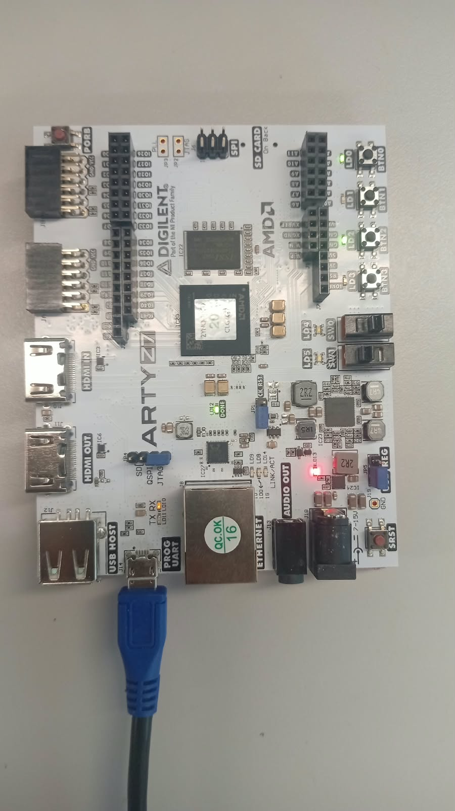
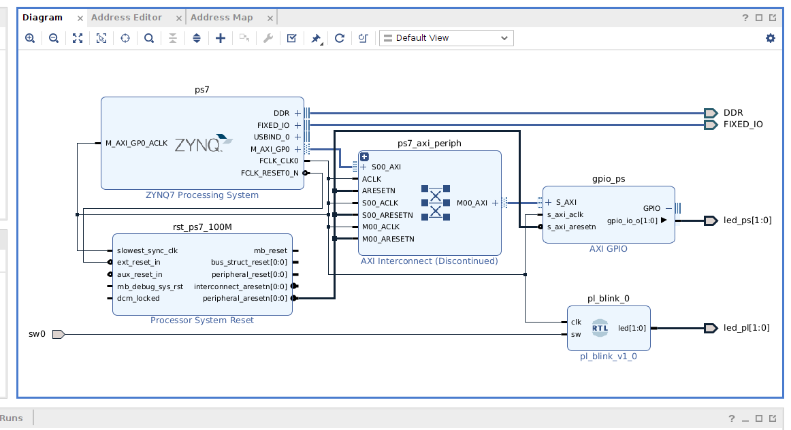
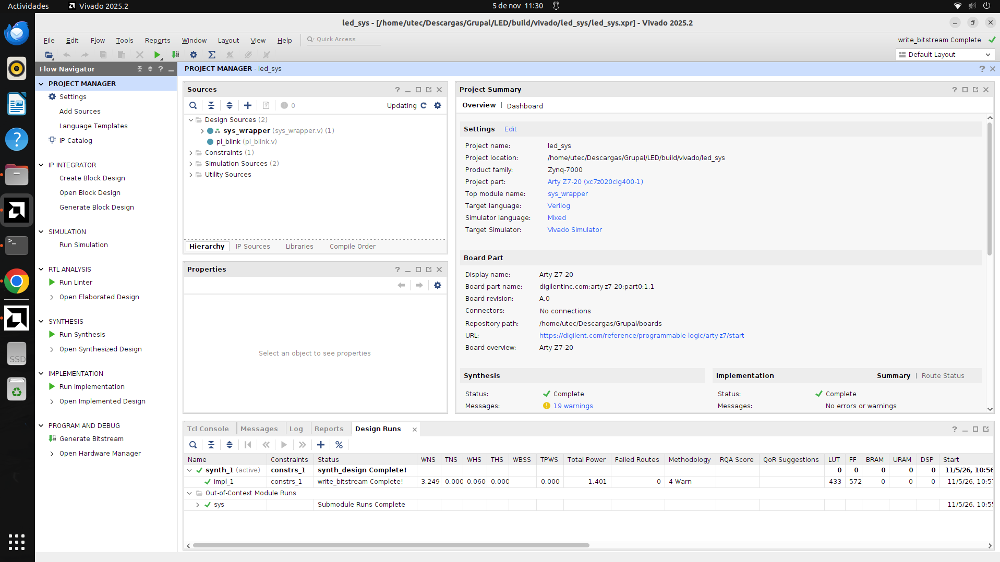
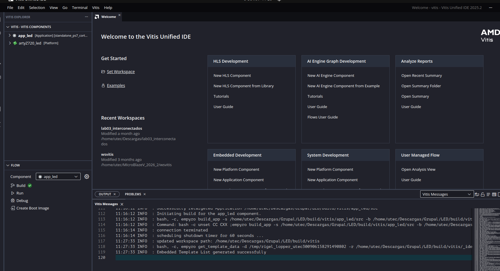
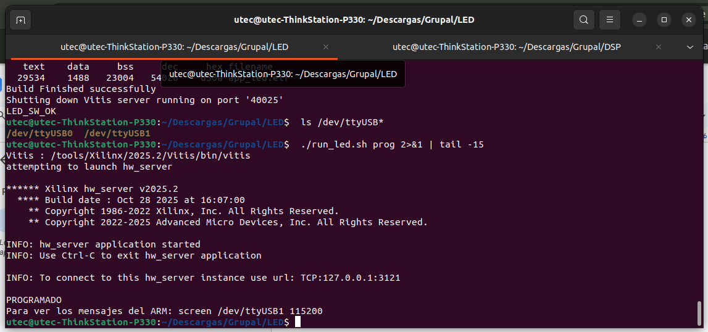
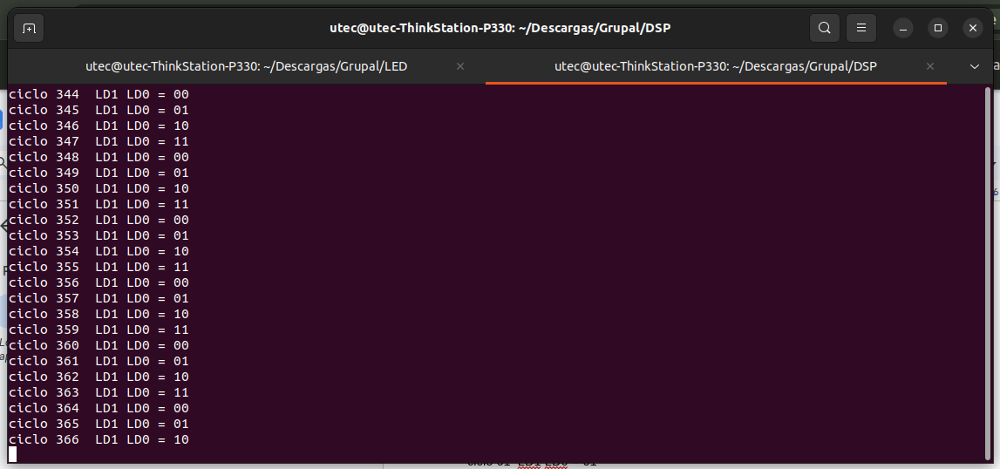
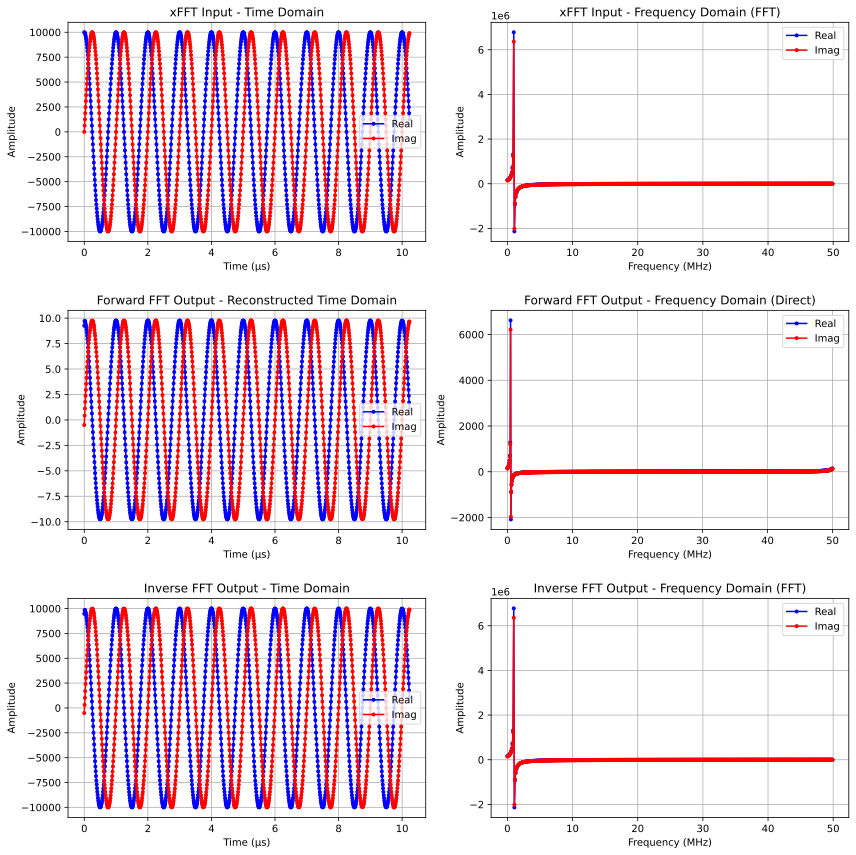

# Laboratorio 6 grupal: Arty Z7-20 con PS y PL, FFT, filtro FIR y potencia

**Integrantes:** Ricardo Amiel Acuña Villogas y Yanelit Picon Huaman

Curso de Señales Biológicas, semana 13. Herramientas: Vivado y Vitis 2025.2 sobre Ubuntu.

## Video y material

| Recurso | Enlace |
|---|---|
| Repositorio | [Arty-ZYNQ-7000---Laboratorio-6](https://github.com/ricardoamiel/Arty-ZYNQ-7000---Laboratorio-6) |
| Video de la placa funcionando | [Ver en Drive](https://drive.google.com/file/d/15j47dAb3DASq5ieea0aM342emI3dTVuM/view?usp=sharing) |
| Carpeta con todo el material | [Carpeta en Drive](https://drive.google.com/drive/folders/1psmLtL21YHwi7eiOAoLBj23YtwVGnrsq?usp=sharing) |

## Capturas

**Arty Z7-20 en funcionamiento:** LD0 encendido por el procesador, LD2 por el contador de la FPGA y LD12 (DONE) con la FPGA configurada.



**Diseño de bloques en Vivado 2025.2:** PS7, AXI GPIO hacia los LEDs del procesador y el módulo RTL pl_blink hacia los LEDs de la FPGA.



**Proyecto implementado en Vivado:** síntesis, implementación y bitstream completos; 433 LUT, 572 FF y 1.401 W estimados.



**Vitis Unified IDE 2025.2:** plataforma standalone y aplicación app_led compiladas.



**Programación por JTAG y salida de la UART:** el procesador recorre el contador de dos bits cada 500 ms.

| Programación | Consola serial |
|---|---|
|  |  |

**Simulación de la FFT:** entrada, salida directa e inversa del núcleo xFFT (pico en k = 10 para un tono de 1 MHz).



## Qué se hizo

1. **LED con la FPGA y el procesador:** LD0 y LD1 los controla el ARM Cortex A9 con un programa en C (AXI GPIO); LD2 parpadea a 1 Hz con un contador en Verilog y LD3 sigue al switch SW0, sin intervención del procesador.
2. **Simulación de la FFT y del filtro FIR:** núcleos xFFT 9.1 y FIR Compiler 7.2 simulados en xsim, con figuras vectoriales generadas en Python.
3. **Consumo de potencia:** estimación con report_power de Vivado para los tres diseños y análisis en el informe.

## Estructura

| Carpeta | Contenido |
|---|---|
| LED | Verilog, restricciones, programa en C y scripts de Vivado, Vitis y programación |
| DSP | Proyecto del curso con los núcleos DSP, simulación sin interfaz (sim_todo.sh) y figuras en resultados |
| informe | Informe en LaTeX: informe.tex (individual) e informe_grupal.tex (con ambos integrantes), figuras y reportes de potencia |
| evidencias | Foto de la placa y capturas de Vivado, Vitis y las terminales |
| boards | Board files de Digilent para la Arty Z7-20 |
| instalacion | Configuración de la instalación mínima de Vivado y Vitis (solo Zynq 7000) |

## Cómo reproducirlo

Ver GUIA.md para los comandos por terminal y GUIA_UI.md para el mismo flujo con la interfaz gráfica. En resumen:

```
source entorno.sh
cd DSP && ./sim_todo.sh
cd ../LED && ./run_led.sh todo
cd ../informe && python3 extraer_potencia.py && pdflatex informe_grupal.tex
```
